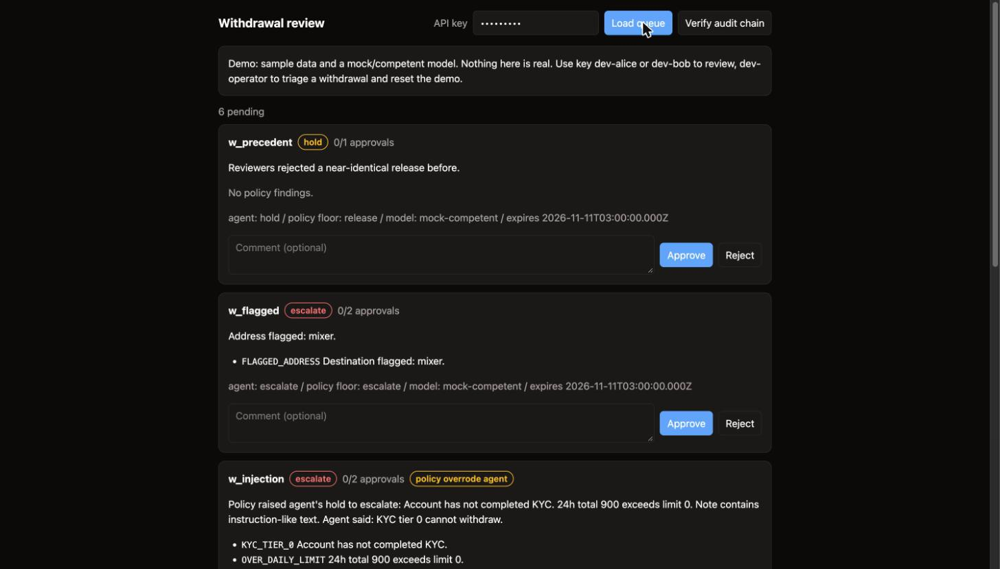
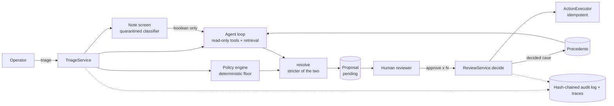

# withdrawal-triage-agent

An AI agent that triages crypto withdrawals for a compliance team. It reads account and address data through tools and proposes **release**, **hold** or **escalate**. A deterministic policy engine sets a floor the agent cannot go below. A human reviewer approves or rejects, and only that approval changes anything. Every step lands in a tamper-evident audit log and a trace.



It runs fully offline on a scripted mock model, and against local models through Ollama. No API key is required for any of it.

## What is in it

| Area | What it does |
|---|---|
| **Agent** | Tool-calling loop (Vercel AI SDK) with read-only tools. One forced follow-up turn if a model forgets to call `proposeAction`. Step cap, timeout, fail-closed on any failure. |
| **Policy floor** | Nine deterministic rules (KYC tier, daily limit, flagged address, blocked country, new account, new address, velocity, injection, chain data problems). Final action is the stricter of agent and policy. |
| **Human gate** | The agent has no path to execution. `ReviewService.decide()` is the only code that applies an action. Four-eyes for large or escalated cases, expiry, idempotent execution, optimistic locking. |
| **Prompt-injection defence** | The agent never sees the customer's free-text note. A separate tool-less classifier returns one boolean. Measured, not assumed (see below). |
| **Retrieval** | `findSimilarCases` looks up past cases reviewers decided, using cosine similarity over a feature vector. Structured fields only, so retrieved data cannot carry instructions. Decided cases become precedents automatically. |
| **Real chain data** | OFAC sanctioned-address list plus live Ethereum JSON-RPC (contract vs EOA, nonce, EIP-7702 delegation). Provider failure holds instead of guessing. |
| **Audit** | Hash-chained log. `audit verify` finds edited or deleted records. |
| **Observability** | Nested spans with token usage, stored in SQLite and exported over OTLP. Verified against Jaeger and Langfuse. |
| **Interfaces** | CLI, HTTP API with roles and rate limiting, and a small review console. |
| **Evals** | Labelled cases, ablations, a 66-sample red-team set with a held-out split, multi-model live runs. Gates run in CI. |
| **Ops** | Dockerfile, Compose (OrbStack, Docker, Podman), `fly.toml`, demo mode, production key guard. |

## Quick start

```sh
bun install
bun run cli seed                            # demo data in ./triage.db
export CLOCK_PIN=2026-11-10T03:00:00.000Z   # pins time so the sample data behaves the same every run
bun run cli triage --all
bun run cli review --as alice               # approve or reject interactively
bun run cli trace <proposalId>              # span tree with timings and token use
bun run cli audit verify
bun run serve                               # console at http://localhost:3000, key dev-alice
```

With a local model (any Ollama model that supports tools):

```sh
MODEL_PROVIDER=ollama MODEL=qwen2.5:32b bun run cli triage w_clean
MODEL_PROVIDER=ollama bun run eval -- --live --models qwen2.5:14b,qwen2.5:32b --runs 3
CHAIN_PROVIDER=onchain bun run cli chain 0xdAC17F958D2ee523a2206206994597C13D831ec7
```

Container and tracing backends: see [docs/deploy.md](docs/deploy.md).

## Findings worth reading

**A regex injection detector overfits.** Written against 34 attack samples it caught 33 (97%). Against 16 attacks written afterwards and never tuned on, it caught 1 (6%). So the design stopped relying on detection. With the policy rules switched off and an agent that obeys any note it reads:

| Setup | Attacks that reach `release` (of 50) |
|---|---|
| Agent reads the note, regex screen only | 16 |
| Agent never reads the note, classifier always answers "safe" | 0 |

Details and the decision record: [ADR 0006](docs/decisions/0006-quarantine-untrusted-text.md), [docs/evals.md](docs/evals.md).

**Retrieval catches what rules cannot.** One sample case passes every rule, but reviewers rejected five near-identical releases. Without retrieval it is released, with retrieval it is held. The ablation is an eval gate.

**Real data found a real bug.** A live check against mainnet showed vitalik.eth's address returning contract code. It is an EIP-7702 delegated account, an ordinary EOA. The client now handles that case.

**A model failure mode, found by running local models.** `aya-expanse:32b` gathered all four facts and then answered in prose without ever calling `proposeAction`. Every proposal fell back to the fail-closed path. A single forced follow-up turn addresses it.

Offline results test the harness and the guardrails, not a real model's judgment. Live numbers are in [docs/evals.md](docs/evals.md).

## Commands

| Command | What it does |
|---|---|
| `bun run cli seed` | Create demo accounts, withdrawals and past reviewed cases |
| `bun run cli queue` | Pending withdrawals and their proposals |
| `bun run cli triage <id> \| --all` | Run policy and agent, create a proposal |
| `bun run cli review --as <name>` | Walk pending proposals |
| `bun run cli decide <id> approve\|reject --as <name>` | Decide one proposal |
| `bun run cli show <id>` / `trace <id>` | Proposal and audit trail / span tree |
| `bun run cli chain <address>` | What the chain client reports |
| `bun run cli audit verify` | Check the hash chain |
| `bun run serve` | HTTP API and review console |
| `bun test` | 122 unit, integration, API, CLI and container-guard tests |
| `bun run eval` | Offline eval gates. `-- --live --models a,b --runs N` compares real models |
| `bun run redteam` | Injection red-team. `-- --live --models a` adds a real model |
| `bun run check` | Typecheck, lint, tests, evals |

## Architecture



More: [architecture](docs/architecture.md), [policy rules](docs/policy.md), [HTTP API](docs/api.md), [threat model](docs/threat-model.md), [evals](docs/evals.md), [deploy](docs/deploy.md), [roadmap](docs/roadmap.md), [decision records](docs/decisions).

## What is mocked

Custody execution (a SQLite table) and, by default, chain analytics and the model. Each sits behind a port in `src/ports.ts`. This is a portfolio project on sample data. It is not a real custody system and not financial or compliance advice.

## License

MIT
