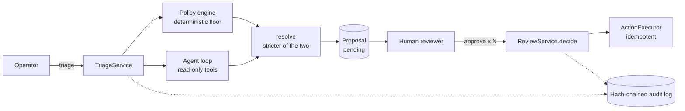

# withdrawal-triage-agent

An AI agent that triages crypto withdrawals for a compliance team. The agent reads account and address data through tools and proposes **release**, **hold** or **escalate**. A deterministic policy engine sets a floor the agent cannot go below. A human reviewer approves or rejects, and only that approval changes anything. Every step lands in a tamper-evident audit log.

It runs fully offline against a scripted mock model, so you can exercise everything before spending on an API key.

## Why it is built this way

- **The model proposes, it never executes.** The agent has no tool that changes state. `ReviewService.decide()` is the only code path that applies an action, and it needs an authenticated reviewer.
- **Policy is a floor, not a suggestion.** Hard rules (KYC tier, limits, flagged address, blocked country, velocity) run independently of the model. The final action is the stricter of the two, so a lenient or manipulated model cannot loosen it.
- **Failure closes.** Timeouts, errors and a model that never answers all produce a `hold` for human review.
- **Untrusted text stays untrusted.** User notes pass through sanitising, an injection heuristic and a labelled `untrusted` field. A flagged note raises a finding.
- **The audit trail is checkable.** Each record hashes the previous one. `audit verify` finds edits and deletions.

## Quick start

```sh
bun install
bun run cli seed                       # demo data in ./triage.db
export CLOCK_PIN=2026-11-10T03:00:00.000Z   # pins time so the seed data behaves the same every run
bun run cli queue
bun run cli triage --all
bun run cli review --as alice          # approve or reject interactively
bun run cli audit verify
bun run serve                          # review console at http://localhost:3000, token dev-alice
```

No API key is needed. `MODEL_PROVIDER` defaults to `mock`. See [`.env.example`](.env.example).

## Commands

| Command | What it does |
|---|---|
| `bun run cli seed` | Create demo accounts and withdrawals |
| `bun run cli queue` | Pending withdrawals and their proposals |
| `bun run cli triage <id> \| --all` | Run policy and agent, create a proposal |
| `bun run cli review --as <name>` | Walk the pending proposals |
| `bun run cli decide <id> approve\|reject --as <name>` | Decide one proposal |
| `bun run cli show <proposalId>` | Proposal detail and audit trail |
| `bun run cli audit verify` | Check the hash chain |
| `bun run serve` | HTTP API and review console |
| `bun test` | Unit, integration, API and CLI tests |
| `bun run eval` | Offline eval gates (add `-- --live` for a real model) |
| `bun run check` | Typecheck, lint, tests and evals |

## Architecture in one picture



Details in [docs/architecture.md](docs/architecture.md). Other docs: [policy rules](docs/policy.md), [HTTP API](docs/api.md), [threat model](docs/threat-model.md), [evals](docs/evals.md), [roadmap](docs/roadmap.md), and [decision records](docs/decisions).

## Project layout

```
src/
  domain/       types, errors
  policy/       rules and the engine
  guardrails/   injection detection, sanitising, action resolution
  agent/        tools, prompt, triage orchestration, model factory, mock models
  workflow/     review service (the only way to change state)
  adapters/     SQLite store and audit log, mock chain client, tracers
  server/       HTTP handler, rate limiter, review console
  cli/          command line
evals/          dataset, harness, runner
tests/          unit, integration, API, CLI
docs/           architecture, policy, API, threat model, evals, ADRs
```

## What is mocked

Chain analytics (`MockChainClient`), custody execution (a SQLite table), and the model in offline mode. Each sits behind a port in `src/ports.ts`, so replacing one is a single adapter. The offline evals test the harness and guardrails. They cannot say how a real model behaves. See [docs/evals.md](docs/evals.md).
