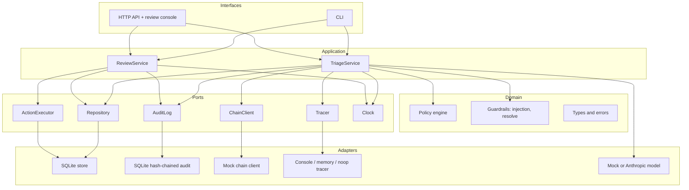
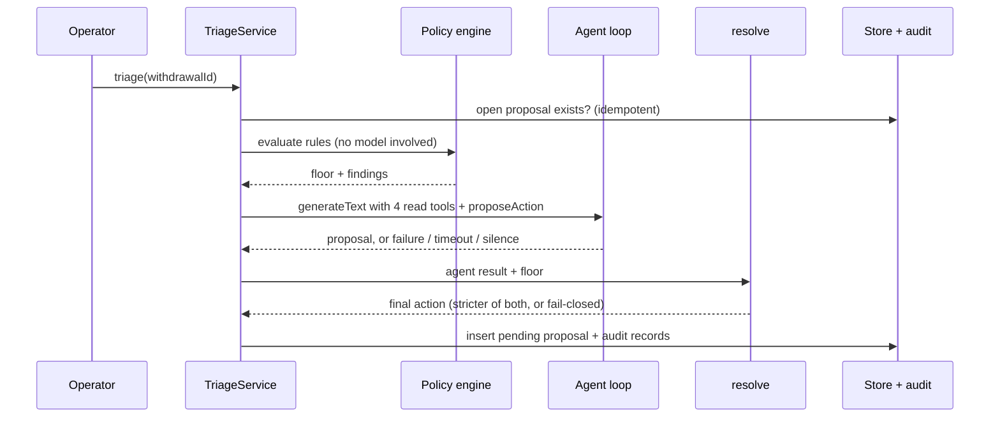
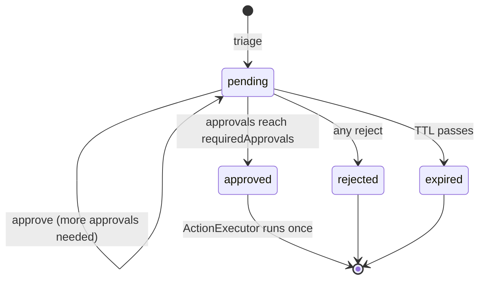

# Architecture

## Layers

`src/container.ts` is the composition root and the only place concrete adapters are chosen. Everything else depends on the interfaces in `src/ports.ts`.

## Triage sequence

## Proposal state machine

A rejected or expired proposal leaves the withdrawal in `pending_review`, so it can be triaged again. An approved one cannot.

## Key rules

| Rule | Where |
|---|---|
| The model cannot apply an action | No tool reaches `ReviewService`; `proposeAction` only fills an in-memory slot |
| Tools are bound to one withdrawal | `buildTools(ctx)` closes over the id; the model passes no ids |
| Final action is at least as strict as policy | `resolve()` takes `maxAction(agent, floor)` |
| Agent failure fails closed | `resolve(null, ...)` returns at least `hold` and marks the proposal `degraded` |
| Four eyes for large or escalated actions | `requiredApprovals` is 2 at 25k USD or when the final action is `escalate` |
| A reviewer cannot approve twice | Checked in `ReviewService.decide` |
| One execution per proposal | Idempotency key `proposal:<id>` with a unique index |
| No lost updates | Optimistic version check in `updateProposal` |

## Observability

Every tool call, policy result, agent proposal, failure, review decision and execution is an audit record carrying a `traceId`. The same id is the OpenTelemetry trace id, so an audit trail and its span tree line up.

Spans are nested (`triage` > `policy`, `agent` > `tool.*`) and carry timings, errors, and `gen_ai.*` attributes for model, temperature and token usage. They are always stored in SQLite and shown by `bun run cli trace <proposalId>`. Setting `OTLP_ENDPOINT` also exports them as OTLP/HTTP JSON to an OpenTelemetry collector or a Langfuse instance (`<host>/api/public/otel`). Export is best effort and never fails a triage. `LOG_LEVEL=debug` also prints spans as JSON lines.
